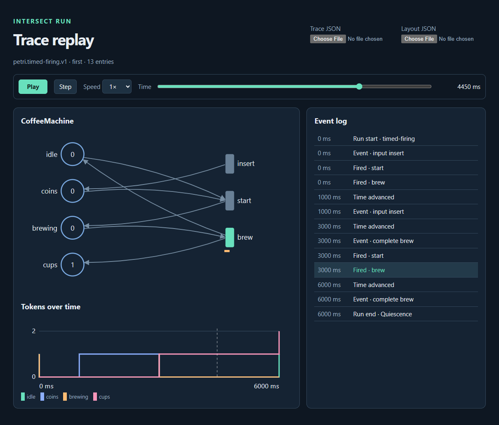

# Intersect language examples

Try Intersect Toolkit in your browser to edit a model, inspect its objects and references, and download a runnable Rust project. Start with the Library starter under **File → Starter projects**, then use **File → Download ready-to-run ZIP** to take a valid model into a local Rust project. [Open Toolkit](https://mercurio-labs.github.io/intersect-lang-examples/toolkit/) · [Toolkit guide](toolkit/README.md#explorer-language-helpers-and-runnable-downloads)

## Browser examples

The gallery pairs live demos with their language definitions, sample models, and Rust walkthroughs. [Browse the examples](https://mercurio-labs.github.io/intersect-lang-examples/)

- Edit Library objects and text in sync, follow references, and try undo and redo. [Library simulator](https://mercurio-labs.github.io/intersect-lang-examples/examples/library/)
- Run a timed Petri net and replay its trace. [Petri simulation](https://mercurio-labs.github.io/intersect-lang-examples/examples/petri/)
- Follow resolved references between two files. [Catalog explorer](https://mercurio-labs.github.io/intersect-lang-examples/examples/catalog/)
- Step through timed commands and replay state transitions. [Stopwatch simulator](https://mercurio-labs.github.io/intersect-lang-examples/examples/stopwatch/)

This candidate Toolkit builds from exact Model and Text source revisions. The
downloadable Rust runner still uses registry `0.1.0-alpha.1`, pending the next
registry release. The native examples and the Petri, Catalog, and Stopwatch
browser adapters still depend on the earlier private combined core. Building
those examples or the whole Pages site requires read access to that repository.
[Toolkit runtime manifest](toolkit/runtime.json) · [Runner dependencies](toolkit/runner/Cargo.toml) · [Native examples workspace](Cargo.toml)

The browser demos run in WebAssembly workers. Petri browser runs accept up to 64 KiB each of model and scenario text, 1,000 scenario inputs, a one-hour horizon, and unsigned 32-bit seeds. They enforce 1,000 steps per instant and 10,000 total steps and events. The UI reports when a budget stops a run and lets you cancel work.

## Lifecycle examples in code

Run these from the repository root with access to the pinned combined core. The walkthroughs write artifacts under `target/runs/`. Each language guide describes the outputs and how to rerun its example.

| Walkthrough | What it shows | Command |
| --- | --- | --- |
| [Library](languages/library/examples/library_lifecycle.rs) | Compile Rcore behavior, evaluate a derived feature, invoke an operation, and restore a model | `cargo run --locked --profile test-fast -p examples-library --example library_lifecycle` |
| [Catalog](languages/catalog/examples/catalog_lifecycle.rs) | Load two resources, resolve references, and build and restore a language pack | `cargo run --locked --profile test-fast -p examples-catalog --example catalog_lifecycle` |
| [Petri](languages/petri/examples/petri_lifecycle.rs) | Validate a net, run a timed scenario, and replay its trace | `cargo run --locked --profile test-fast -p examples-petri --example petri_lifecycle` |
| [Stopwatch](languages/stopwatch/examples/stopwatch_lifecycle.rs) | Parse commands, execute timed state transitions, and save observations | `cargo run --locked --profile test-fast -p examples-stopwatch --example stopwatch_lifecycle` |

Language guides cover the definitions, expected outputs, and supported operations. [Library](languages/library/README.md) · [Catalog](languages/catalog/README.md) · [Petri](languages/petri/README.md) · [Stopwatch](languages/stopwatch/README.md)

## Code and API reference

The Toolkit runner's public library API covers loading, inspecting, unpacking, and building a model pack. Build a searchable HTML reference with Rustdoc from the repository root. This uses the standalone runner's crates.io dependencies.

```sh
cargo doc --manifest-path toolkit/runner/Cargo.toml --locked --lib --no-deps --open
```

Follow the API through the small native examples and the implementation. [Load a pack](toolkit/runner/examples/load_pack.rs) · [Build a pack](toolkit/runner/examples/build_pack.rs) · [Runner API source](toolkit/runner/src/lib.rs) · [Cargo documentation guide](https://doc.rust-lang.org/cargo/commands/cargo-doc.html)

The upstream repositories document the modeling and text APIs. [Intersect Model](https://github.com/mercurio-labs/intersect-model) · [Intersect Text](https://github.com/mercurio-labs/intersect-text)

## Build and preview locally

For Toolkit alone, install Git, Rust with the `wasm32-unknown-unknown` target, and Node.js 22.15 or newer. Run the following from the repository root and open `http://127.0.0.1:4173/`. [Full Toolkit build and tests](toolkit/README.md#full-workbench-development) · [Focused Model/Text alpha build](toolkit/README.md#focused-modeltext-alpha)

```sh
rustup target add wasm32-unknown-unknown
npm --prefix toolkit ci
npm --prefix toolkit run build
npm --prefix toolkit run preview -- --host 127.0.0.1 --port 4173 --strictPort
```

To build the whole site, also install Python 3, `wasm-pack` 0.14.0, and configure Git access to the combined core named in the workspace manifest. Open `http://localhost:8000/` so the browser can load the module workers over HTTP.

```sh
cargo install wasm-pack --version 0.14.0 --locked
python -B tools/build_web.py
node tools/check_web.mjs
python -m http.server 8000 --directory dist
```

Successful Browser examples workflow runs also provide a ready-to-serve `examples-site` artifact. [Browser examples workflow](.github/workflows/web.yml)

### Publish the GitHub link

The Browser examples workflow builds the site, checks actual WASM at the Pages project prefix, and uploads the result. For maintainers, set **Settings → Pages → Source** to **GitHub Actions**, give `INTERSECT_CORE_TOKEN` read access to the pinned private core, and allow `main` in the `github-pages` environment. Dispatch the workflow on `main` with **Publish the tested playground to GitHub Pages** enabled. [Browser examples workflow](.github/workflows/web.yml)

## Run and replay

Run the Petri example with the named scenario and open `http://localhost:8000/viewer/` to choose the generated trace. You can pass the trace as `?trace=../target/runs/coffee.trace.json`. An optional layout JSON maps stable node IDs to `{"x": number, "y": number}` and can be loaded with the picker or a relative `layout` URL.

```sh
cargo run --locked -p examples-run -- petri languages/petri/models/coffee.petri --scenario languages/petri/scenarios/two-coins.scenario.json --until 20s --policy first --out target/runs/coffee.trace.json
python -m http.server 8000
```



Use `examples-run catalog check` or `examples-run library check` to check the bundled model. Add paths after `check` to use your own inputs.

## Compiled language packs

Build a host-local language pack, then load it in a new runner invocation. The pack retains the compiled grammar, schema, source provenance, and verified Rcore bindings. The runner checks integrity and compiler and source identities before restoring it. Rebuild after changing the compiler or language definition, and use packs from sources you trust.

```sh
cargo run --locked -p examples-run -- pack catalog target/packs/catalog.pack
cargo run --locked -p examples-run -- catalog check --pack target/packs/catalog.pack
cargo run --locked -p examples-run -- pack petri target/packs/petri.pack
cargo run --locked -p examples-run -- petri languages/petri/models/coffee.petri --pack target/packs/petri.pack --scenario languages/petri/scenarios/two-coins.scenario.json --until 20s --out target/runs/coffee-packed.trace.json
```

Toolkit's model pack includes the authored model and editable files in addition to its compiled language. [Toolkit model pack workflow](toolkit/README.md#explorer-language-helpers-and-runnable-downloads)

## Checks

Read the contributor guide for test tiers. Run these checks for the native examples after configuring access to the pinned private core. Full browser and Pages checks run in the web workflow. [Contributor guide](AGENTS.md) · [Native CI](.github/workflows/ci.yml) · [Browser CI](.github/workflows/web.yml)

```sh
cargo fmt --all --check
cargo clippy --workspace --all-targets --locked -- -D warnings
python -B tools/test_report.py run -- --profile test-fast --workspace --lib --bins --tests --locked
```

### Working with a local core

Check out the pinned combined core revision in a sibling directory named `intersect`. To test local edits in those crates, supply Cargo's path patches on the command line. Use the same patches for Clippy.

```sh
python -B tools/test_report.py run -- --profile test-fast --workspace --lib --bins --tests \
  --config 'patch."https://github.com/mercurio-labs/intersect".intersect-model.path="../intersect/crates/intersect-model"' \
  --config 'patch."https://github.com/mercurio-labs/intersect".intersect-xtext.path="../intersect/crates/intersect-xtext"' \
  --config 'patch."https://github.com/mercurio-labs/intersect".intersect-run.path="../intersect/crates/intersect-run"'
```

The patches can rewrite the local lockfile. Commit lockfile changes only with the intended Git revision resolved. A fresh offline build needs the revision in Cargo's Git cache.
